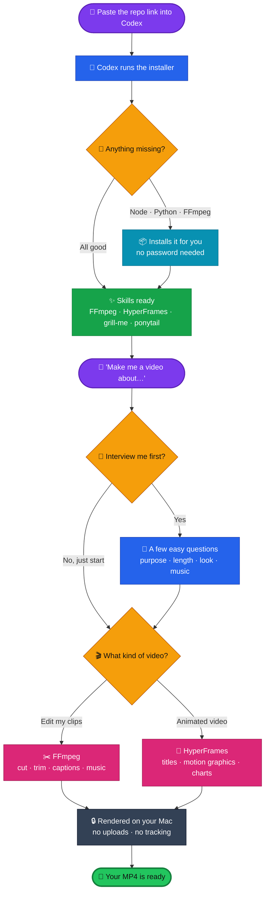

# VDO for LTD

A set of video-making skills for **Codex** and **Claude Code**, installed with one command.

**Easiest way:** paste this into Codex or Claude Code:

> Install this for me: https://github.com/chanooooot/VDO-for-LTD

## How it works



## Instructions for AI agents installing this

If a user asked you to install this repo, follow these steps exactly. The user may not be technical: use plain, friendly words, no jargon, and never ask them to edit files or type commands.

1. **Do not** install it by copying a skill folder (for example with a skill-installer). That skips most of the bundle. Run the installer script below instead.
2. Run this one command (it needs network access and writes outside the project, so request approval if your sandbox asks, and allow at least 10 minutes):
   ```bash
   f="$(mktemp)" && curl -fsSL https://raw.githubusercontent.com/chanooooot/VDO-for-LTD/main/skills/vdo-for-ltd/install.sh -o "$f" && bash "$f"
   ```
   If the user needs to click "Approve" or "Allow", tell them in one short sentence what to click and why.
3. Read the summary at the end of the output. If there is no output at all, or the download failed, the network was blocked: request network access and run step 2 again.
   - "All done": tell the user it worked, and that they should quit and reopen the app. After that they can just describe the video they want.
   - "npx not found": the user needs Node.js. Tell them: "Please open https://nodejs.org, download the LTS version, and double-click it to install, like any other app. Tell me when it's done." Then run step 2 again.
   - "everything works except video stabilisation": this is expected on Macs without Homebrew and counts as success. Do not try to fix it and do not mention it unless the user later asks to stabilise shaky footage.
   - "No Python 3.10+ found" or "Could not install Python 3.10+": tell them: "Please open https://www.python.org/downloads/, click the big yellow Download button, and double-click the file to install. Tell me when it's done." Then run step 2 again.
   - Anything else: fix it yourself if you can, then run step 2 again. Only ask the user when you truly need them.
4. Never show the user raw error output unless they ask. Summarise in one sentence.

## What it installs

| Skill | Source | What it does |
|---|---|---|
| ffmpeg-skill | [kajisho5/ffmpeg-skill](https://github.com/kajisho5/ffmpeg-skill) | Cut, trim, caption and convert video/audio with FFmpeg |
| HyperFrames (core skills) | [heygen-com/hyperframes](https://github.com/heygen-com/hyperframes) | Make animated videos from HTML. Free and open source (Apache-2.0), no licence fees |
| ponytail (main skill only) | [DietrichGebert/ponytail](https://github.com/DietrichGebert/ponytail) | Smallest-change coding mode: lean code and replies |
| grill-me + grilling | [mattpocock/skills](https://github.com/mattpocock/skills) | Interviews you to sharpen a plan |
| video-kickoff | this repo | Before any video task, asks if you'd like a few planning questions first, and keeps the work lean on tokens (few frame checks, live preview instead of repeated renders, short replies) |
| hyperframes-local-render | this repo | Keeps HyperFrames on your Mac: local rendering only, no uploads, usage tracking off |

## Manual install

Needs Node.js. No Homebrew and no password needed. The installer also:

- installs Node.js 22 if yours is older (HyperFrames needs it);
- turns off usage tracking (`HYPERFRAMES_NO_TELEMETRY=1`, `DO_NOT_TRACK=1`);
- removes Remotion skills from earlier versions of this bundle;

- makes sure `python3` is 3.10+ (macOS ships 3.9): it uses a newer Python if you have one, or installs one (Homebrew if present, otherwise [pixi](https://pixi.sh) into `~/.pixi`), then points `python3` at it through `~/.local/bin`;
- installs FFmpeg if missing (Homebrew `ffmpeg-full` if present, otherwise conda-forge FFmpeg through pixi, which has everything except video stabilisation);
- adds the needed lines to `~/.zprofile` and `~/.zshrc`.

**Option A: one command in Terminal**

```bash
f="$(mktemp)" && curl -fsSL https://raw.githubusercontent.com/chanooooot/VDO-for-LTD/main/skills/vdo-for-ltd/install.sh -o "$f" && bash "$f"
```

This installs this repo's skills plus all the skills above, for both Codex (`~/.agents/skills`) and Claude Code (`~/.claude/skills`).

**Option B: through your agent**

```bash
npx skills add chanooooot/VDO-for-LTD --skill '*' -g -a codex claude-code -y
```

Restart your agent, then ask it to run the installer:
- Codex: type `$vdo-for-ltd`, or pick it from `/skills`
- Claude Code: type `/vdo-for-ltd`

The agent checks your machine and installs everything else.

To install for other agents, set `VDO_AGENTS`, for example `VDO_AGENTS="codex cursor" bash install.sh`.

## Using it

Just describe the video you want. The agent asks whether you'd like it to interview you about the details first. Pick "yes" if you're not sure exactly what you want.

## Update

Re-run `install.sh`, or the installer skill.

## Credits

All bundled skills belong to their authors. This repo only installs them from their original repositories.
